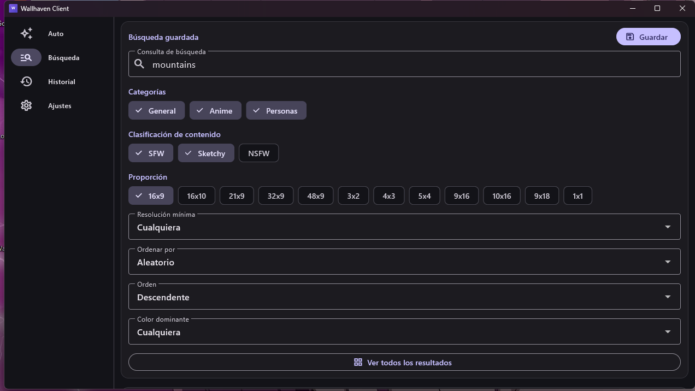
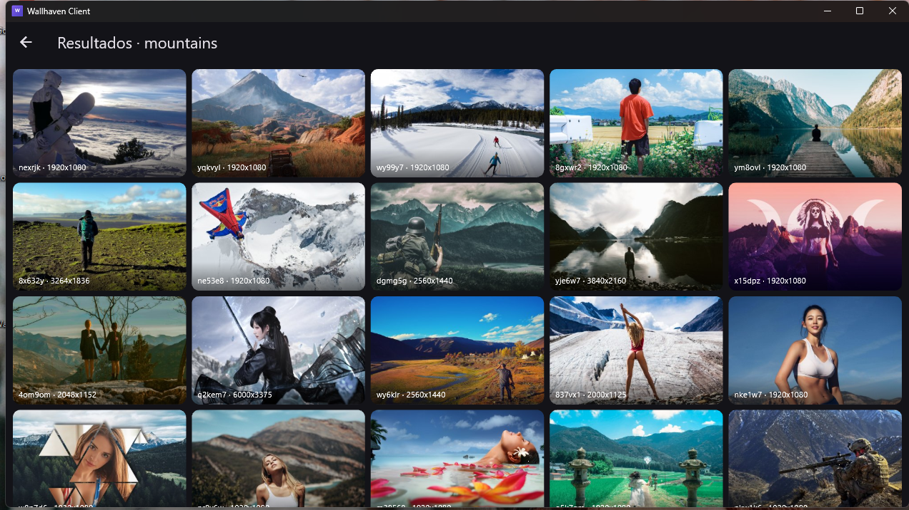

# Wallhaven AutoBG

Cross-platform (Flutter) client for [wallhaven.cc](https://wallhaven.cc): search wallpapers, download them and **rotate your desktop background automatically** based on a saved search.

| Auto | Search | Settings |
| --- | --- | --- |
|  |  |  |

| Gallery | Detail view |
| --- | --- |
|  |  |

## Features

- 🔄 **Automatic wallpaper rotation** every N minutes, with countdown and a "Change now" button.
- 🔍 **Saved search** with the full API filters: query (supports `+tag -tag @user`), categories, content rating, minimum resolution, **aspect ratios** (16x9, 4x3, ...), sorting and dominant color.
- 🖼️ **Infinite-scroll gallery** to browse every result, with a detail view (zoom), set as wallpaper or download.
- 📦 **Batch downloads** from the gallery (selection mode with live progress).
- 🧹 **Auto-cleanup**: keeps only the latest N downloads (configurable) so your disk never fills up.
- 📜 **History** of every applied wallpaper with one-click re-apply and **disk usage stats**.
- 🔑 **Optional API key** to unlock NSFW content.
- 🚀 **Run at system startup** (optional), minimized to the system tray.
- 🌍 i18n ready: Spanish and English included.

## Installation

### Windows
Download **`Wallhaven-AutoBG-Setup-<version>.exe`** from [Releases](../../releases):

1. Double-click the installer (a single .exe file)
2. It installs itself into `Program Files\Wallhaven AutoBG`
3. Creates desktop + Start Menu shortcuts and shows up in Add/Remove Programs

The portable (`...windows-portable.zip`) is also available if you prefer not to install anything.

### Ubuntu/Debian
`wallhaven-autobg_<version>_amd64.deb` — `sudo dpkg -i wallhaven-autobg_*_amd64.deb` (installs to `/opt/wallhaven-client` with an applications-menu entry).

## Building from source

Requires [Flutter](https://docs.flutter.dev/get-started/install) stable (3.27+).

```bash
flutter pub get
flutter run -d linux   # or -d windows
flutter test           # unit tests + UI smoke test
```

To regenerate platform folders from a clean clone:

```bash
flutter create --platforms=windows,linux,android --project-name wallhaven_client .
```

## Technical notes

- **Windows**: applies wallpapers through the `IDesktopWallpaper` COM interface via `dart:ffi` (instant, no shell restart), with a `SystemParametersInfoW` fallback.
- **Linux**: `gsettings` (GNOME/Cinnamon/MATE), `plasma-apply-wallpaperimage` (KDE) or `feh` as fallback.
- Wallhaven's API is limited to **45 requests/minute**; the app handles HTTP 429 gracefully.
- Authentication uses an [API key](https://wallhaven.cc/settings/account) (the API has no password login).

## Roadmap

Follow the progress in [Issues](../../issues):

- [x] System tray (minimize to tray, start hidden) — #3, done in v0.4.1
- [x] Batch downloads from the gallery — #5, done in v0.4.0
- [x] Download stats & history cleanup — #9, done in v0.4.0
- [ ] Android: native wallpaper plugin (`WallpaperManager`) — #1
- [ ] User collections as rotation source — #2
- [ ] Extra filters: exact resolutions and all-wide/all-portrait — #4
- [ ] MSIX (Windows) / Flatpak-Snap (Linux) installers — #6
- [ ] More translations (Portuguese, French, German...) — #7
- [ ] Global hotkey for "Change now" — #8

## License

MIT. All images belong to their original owners (wallhaven.cc).
