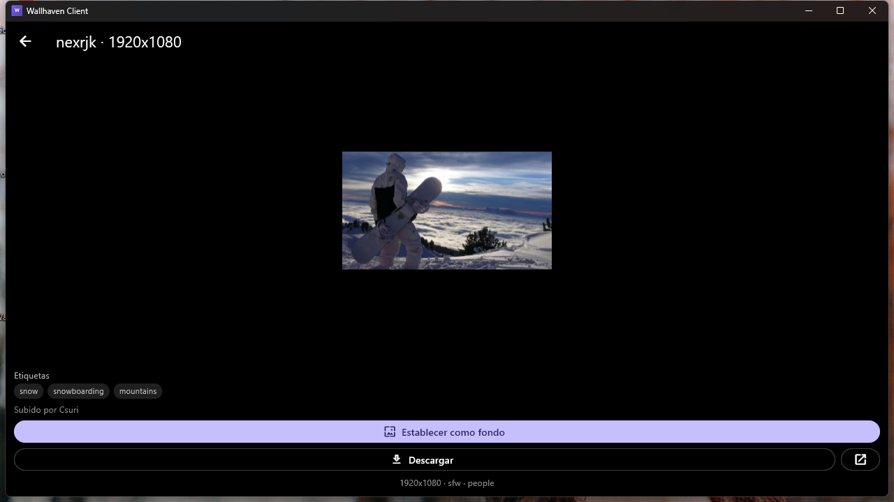

# Wallhaven AutoBG

Cross-platform (Flutter) client for [wallhaven.cc](https://wallhaven.cc): search wallpapers, download them and **rotate your desktop background automatically** based on a saved search.

| Auto | Search | Settings |
| --- | --- | --- |
|  |  |  |

| Gallery | Detail view |
| --- | --- |
|  |  |

## Platforms

| Platform | Wallpaper rotation | Install method |
| --- | --- | --- |
| Windows | ✅ `IDesktopWallpaper` COM | Single-exe setup / portable |
| Linux | ✅ gsettings / plasma / feh | .deb |
| Android | ✅ `WallpaperManager` (foreground service — works with the app closed) | APK |

## Features

- 🔄 **Automatic wallpaper rotation** every N minutes, with countdown and a "Change now" button (also a global hotkey: Ctrl+Alt+W).
- 🔍 **Saved search** with the full API filters: query (supports `+tag -tag @user`), categories, content rating, minimum resolution, **aspect ratios** (16x9, 4x3, all-wide/all-portrait...), **exact resolutions**, sorting and dominant color.
- 📚 **User collections as a rotation source** (requires API key).
- 🖼️ **Infinite-scroll gallery** to browse every result, with a detail view (zoom, tags, uploader, open in browser), set as wallpaper, download.
- 📦 **Batch downloads** from the gallery (selection mode with live progress).
- 🧹 **Auto-cleanup**: keeps only the latest N downloads (configurable) so your disk never fills up.
- 📜 **History** of every applied wallpaper with one-click re-apply and **disk usage stats**.
- 🔑 **Optional API key** to unlock NSFW content.
- 🚀 **Run at system startup** (optional), minimized to the system tray. Closes to the tray so the rotation keeps running.
- 🌍 **Six languages** included: Spanish, English, Portuguese, French and German (switchable in Settings).

## Installation

### Windows
Download **`Wallhaven-AutoBG-Setup-<version>.exe`** from [Releases](../../releases):

1. Double-click the installer (a single .exe file)
2. It installs itself into `Program Files\Wallhaven AutoBG`
3. Creates desktop + Start Menu shortcuts and shows up in Add/Remove Programs

The portable (`...windows-portable.zip`) is also available if you prefer not to install anything.

### Ubuntu/Debian
`wallhaven-autobg_<version>_amd64.deb` — `sudo dpkg -i wallhaven-autobg_*_amd64.deb` (installs to `/opt/wallhaven-client` with an applications-menu entry).

### Android
Two options:
- **Play Store** (recommended): follow [`docs/PLAY_STORE_CHECKLIST.md`](docs/PLAY_STORE_CHECKLIST.md) and install from your listing.
- **Direct APK**: download `wallhaven-autobg_<version>_android.apk` from Releases and install it (allow "install unknown apps" when prompted).

Android notes:
- The rotation runs as a **foreground service** — it keeps working with the app closed (persistent notification).
- Ads (AdMob) are shown on Android; they hide automatically while NSFW content is unlocked (policy compliance). Test IDs are used until real AdMob IDs are configured (see `lib/config/ads.dart`).

## Building from source

Requires [Flutter](https://docs.flutter.dev/get-started/install) stable (3.27+).

```bash
flutter pub get
flutter run -d linux   # or -d windows
flutter test           # unit tests + UI smoke test
```

To regenerate platform folders from a clean clone:

```bash
flutter create --platforms=windows,linux,android --project-name wallhaven_client .
```

## Technical notes

- **Windows**: applies wallpapers through the `IDesktopWallpaper` COM interface via `dart:ffi` (instant, no shell restart), with a `SystemParametersInfoW` fallback.
- **Linux**: `gsettings` (GNOME/Cinnamon/MATE), `plasma-apply-wallpaperimage` (KDE) or `feh` as fallback.
- Wallhaven's API is limited to **45 requests/minute**; the app handles HTTP 429 gracefully.
- Authentication uses an [API key](https://wallhaven.cc/settings/account) (the API has no password login).

## Roadmap

Follow the progress in [Issues](../../issues):

- [x] System tray (minimize to tray, start hidden) — #3, done in v0.4.1
- [x] Batch downloads from the gallery — #5, done in v0.4.0
- [x] Download stats & history cleanup — #9, done in v0.4.0
- [x] Android support (native `WallpaperManager` plugin) — #1, done in v0.6.0
- [x] User collections as rotation source — #2, done in v0.6.0
- [x] Extra filters: exact resolutions and all-wide/all-portrait — #4, done in v0.6.0
- [x] Global hotkey for "Change now" — #8, done in v0.6.0
- [x] More translations (Portuguese, French, German) — #7, done in v0.7.0
- [ ] Code-sign the Windows installer (free via SignPath Foundation for OSS) — #10, signing support already in the workflow (needs secrets)
- [ ] Publish on Google Play — see `docs/PLAY_STORE_CHECKLIST.md` (AdMob + keystore support in v0.9.0)

Closed without implementing: #6 (MSIX/Flatpak installers) — the single-exe setup covers Windows and the .deb covers Linux.

## Troubleshooting (Windows)

**"This program is blocked by group policy"** when running the downloaded installer on a stock Windows — that's the Mark-of-the-Web block applied to unsigned downloaded executables. Fixes (any of them):

```powershell
Unblock-File -Path "C:\path\to\Wallhaven-AutoBG-Setup-<version>.exe"
```

- or right-click the .exe → Properties → check **Unblock** → OK
- don't run the .exe from inside the ZIP preview; extract first
- as a last resort, install [the VC++ redistributable](https://aka.ms/vs/17/release/vc_redist.x64.exe) and use the portable zip

Long-term fix (planned in #6): code-signing the installer removes SmartScreen entirely.

## License

MIT. All images belong to their original owners (wallhaven.cc).
