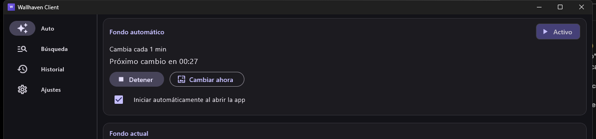
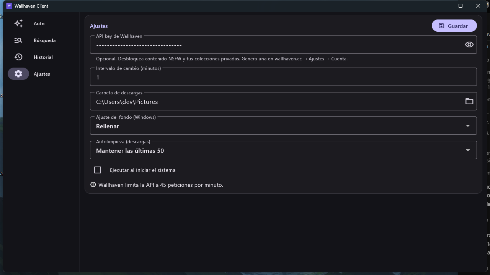

# Wallhaven AutoBG

Cliente multiplataforma (Flutter) para [wallhaven.cc](https://wallhaven.cc): busca wallpapers, descárgalos y **rota tu fondo de escritorio automáticamente** según una búsqueda guardada.

| Auto | Búsqueda | Ajustes |
| --- | --- | --- |
|  |  |  |

| Galería | Vista de detalle |
| --- | --- |
|  |  |

## Características

- 🔄 **Rotación automática del fondo** cada N minutos, con cuenta atrás y "Cambiar ahora".
- 🔍 **Búsqueda guardada** con filtros completos de la API: consulta (soporta `+tag -tag @usuario`), categorías, content rating, resolución mínima, **proporciones** (16x9, 4x3, ...), orden y color dominante.
- 🖼️ **Galería con scroll infinito** para ver todos los resultados, con vista de detalle (zoom), aplicar como fondo o descargar.
- 📦 **Descargas en lote** desde la galería (modo selección con progreso).
- 🧹 **Autolimpieza**: mantiene solo las últimas N descargas (configurable) para no llenar el disco.
- 📜 **Historial** de cada fondo aplicado, con re-aplicar en un clic y **estadísticas de espacio en disco**.
- 🔑 **API key opcional** para desbloquear NSFW.
- 🚀 **Ejecutar al iniciar el sistema** (opcional), minimizado en la bandeja.
- 🌍 i18n preparado: español e inglés incluidos.

## Instalación

Descarga el binario para tu plataforma en [Releases](../../releases):

- **Windows**: `wallhaven-autobg-windows-portable.zip` — descomprime y ejecuta `wallhaven_client.exe` (no requiere instalación).
- **Ubuntu/Debian**: `wallhaven-autobg_*_amd64.deb` — `sudo dpkg -i wallhaven-autobg_*_amd64.deb` (instala en `/opt/wallhaven-client` con entrada en el menú de aplicaciones).

## Compilar desde cero

Requiere [Flutter](https://docs.flutter.dev/get-started/install) estable (3.27+).

```bash
flutter pub get
flutter run -d linux   # o -d windows
flutter test           # tests unitarios + humo de UI
```

Para generar las carpetas de plataforma desde un clon limpio:

```bash
flutter create --platforms=windows,linux,android --project-name wallhaven_client .
```

## Notas técnicas

- **Windows**: el cambio de fondo usa la interfaz COM `IDesktopWallpaper` vía `dart:ffi` (instantáneo, sin reiniciar el shell), con fallback a `SystemParametersInfoW`.
- **Linux**: `gsettings` (GNOME/Cinnamon/MATE), `plasma-apply-wallpaperimage` (KDE) o `feh` como fallback.
- La API de Wallhaven está limitada a **45 peticiones/minuto**; la app gestiona el error 429 sin romperse.
- La autenticación se hace con una [API key](https://wallhaven.cc/settings/account) (la API no soporta login por contraseña).

## Roadmap

Sigue el progreso en [Issues](../../issues):

- [ ] Android: plugin nativo para aplicar fondos (`WallpaperManager`) — [#1](../../issues/1)
- [ ] Colecciones de usuario como fuente de la rotación — [#2](../../issues/2)
- [ ] Arranque minimizado en la bandeja (`--hidden`) — [#3](../../issues/3)
- [ ] Filtros extra: resolución exacta y all-wide/all-portrait — [#4](../../issues/4)
- [ ] Descargas en lote desde la galería — [#5](../../issues/5)
- [ ] Instaladores MSIX (Windows) y Flatpak/Snap (Linux) — [#6](../../issues/6)
- [ ] Más idiomas (portugués, francés, alemán...) — [#7](../../issues/7)
- [ ] Hotkey global para "Cambiar ahora" — [#8](../../issues/8)
- [ ] Estadísticas de descargas y limpieza de historial — [#9](../../issues/9)

## Licencia

MIT. Todas las imágenes pertenecen a sus autores originales (wallhaven.cc).
